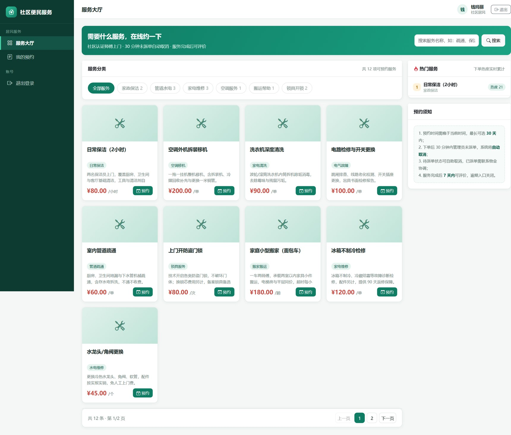
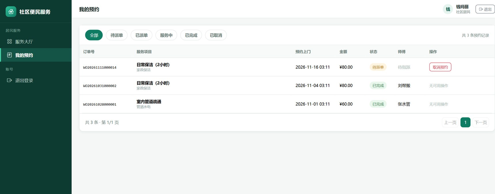
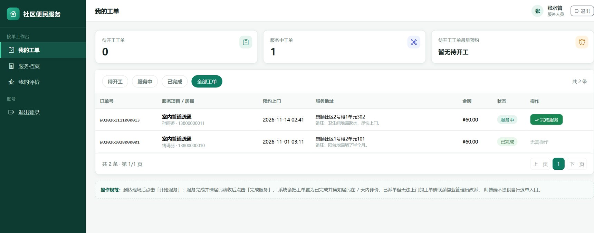
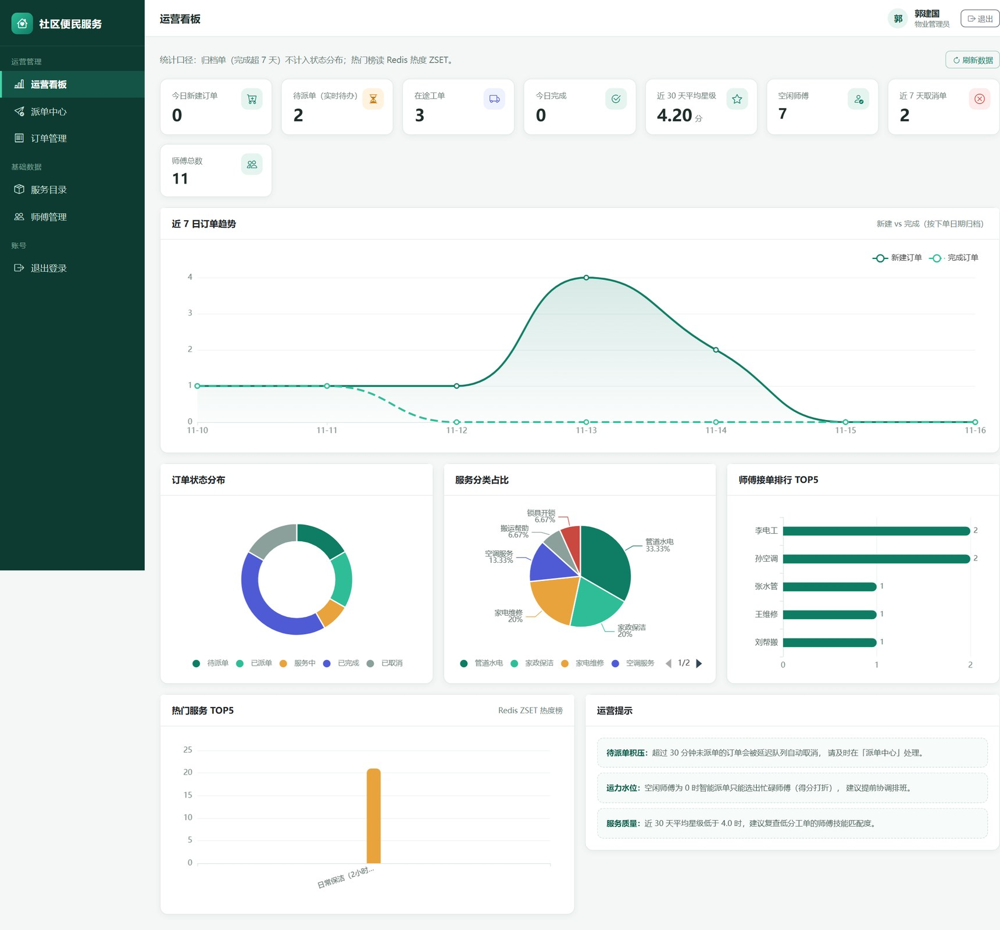
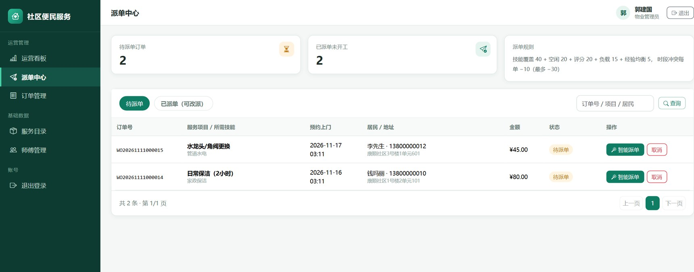
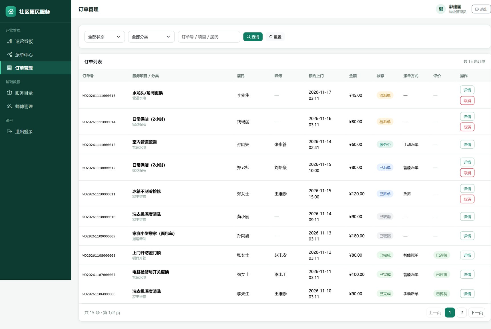
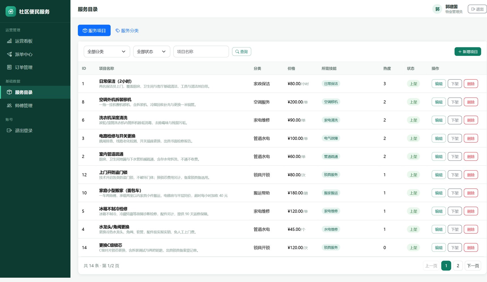
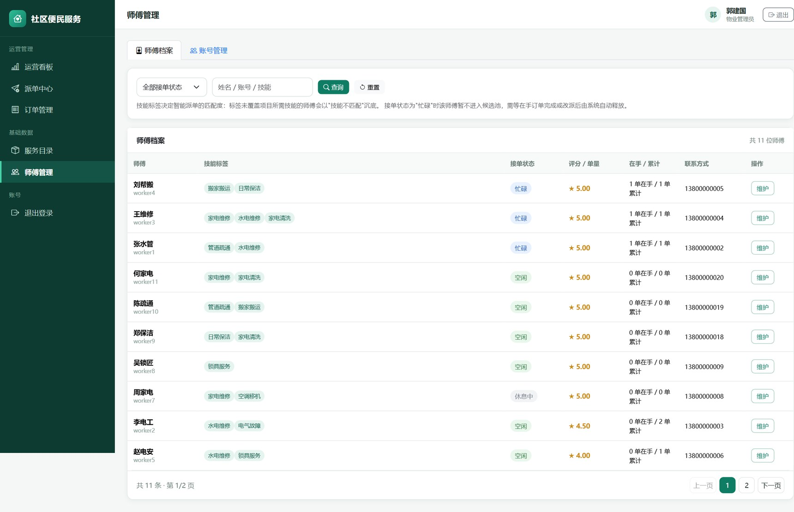

<div align="center">


# 社区便民服务预约系统

**居民在线约服务、管理员一键派单、师傅上门接活——一条订单线全串起来。**

不用再打电话找物业，不用再翻小本子记「谁家水管漏了、派给谁了、修完没有」。
居民点几下就下单，系统按技能、空闲状态、评分、手头活多少自动挑最合适的师傅，
干完活居民打分，分数回头又影响下一次派单。

[](https://openjdk.org/projects/jdk/17/)
[](https://spring.io/projects/spring-boot)
[](https://www.mysql.com/)
[](https://redis.io/)
[](https://www.rabbitmq.com/)
[](https://www.thymeleaf.org/)
[](#五怎么证明它真能跑)
[](#五怎么证明它真能跑)

[三分钟跑起来](#四三分钟跑起来) · [界面速览](#三界面速览) · [一段完整流程](#六走一遍完整流程) ·
[**项目开发文档**](docs/项目开发文档.md) · [**Linux 部署说明**](docs/Linux部署说明.md)

</div>

---

## 一、这是什么

一个面向**社区物业**的便民服务预约平台。居民要修水管、通马桶、搬家具，在手机上挑一项服务下单；
物业管理员在后台看到待派单，系统已经把最合适的师傅排好序，点一下就派出去；
师傅在自己手机上接单、开工、完工；居民收到通知后给个星级和评价。

三个角色、一套订单状态机、一条数据链，谁在什么时候做了什么都有记录。

| 关键数字 | 说明 |
|---|---|
| **3 种角色** | 居民 / 师傅 / 物业管理员，页面和数据权限逐层隔离 |
| **6 张表** | 用户、师傅档案、服务分类、服务项目、订单、评价 |
| **11 个页面 + 1 套公共布局** | 服务端渲染 + ECharts，前端库全部本地化（断网也能跑） |
| **98 个 Java 文件** | 11,306 行，注释率 45%，没有一处 `TODO` 占位 |
| **14 项服务 / 6 个分类** | 上架 12 项可选（保洁、管道、家电、搬运、开锁、电路），另 2 项已下架作演示 |
| **163 项自动化断言** | 冒烟 36 + 数据库自洽 36 + 全链路 91，一条命令重跑 |

> **除了代码，还有两份材料建议看**：
> [项目开发文档](docs/项目开发文档.md)（架构、E-R 图、状态机、派单算法、MQ 拓扑、接口清单）
> 与 [Linux 部署说明](docs/Linux部署说明.md)（依赖安装、systemd、Nginx、排障）。
> 想快速知道每个文件是干什么的，直接看 [文件说明](docs/文件说明.md)。

---

## 二、三个角色，各看各的界面

| 角色 | 账号 | 他能做什么 |
|---|---|---|
| **居民** | `resident1` ~ `resident8` | 逛服务大厅、按分类筛选 / 看热门榜、下单预约（限流：60 秒内最多 3 次）、取消还没派出去的单、完工后 7 天内评价 |
| **师傅** | `worker1` ~ `worker11` | 工单工作台（开始服务 → 完成服务，只能往前走一步）、维护自己的技能标签、切换空闲 / 休息、看自己的评价 |
| **管理员** | `admin` | 运营看板（8 个指标 + 5 张图）、派单中心（智能评分 / 一键派单 / 手动改派 / 运营取消）、订单检索、服务目录（分类、项目、上下架、封面图）、师傅与账号管理 |

密码统一 `123456`（数据库里存的是 BCrypt 密文）。

---

## 三、界面速览

### 居民端：挑服务、下单、看进度，就这三件事

<table>
  <tr>
    <td width="52%"></td>
    <td width="48%"></td>
  </tr>
  <tr>
    <td align="center"><sub><b>服务大厅</b>：12 项服务、6 个分类，右上角实时热门榜（Redis ZSET 算的）</sub></td>
    <td align="center"><sub><b>我的预约</b>：只看自己的单；待派单可以自己取消，已派单得找管理员</sub></td>
  </tr>
</table>

### 师傅端：只有两个按钮，没有第三个



<p align="center"><sub>工单工作台：待开工 / 服务中 / 已完成 三个页签；<b>开始服务</b>只能从「待开工」点，<b>完成服务</b>只能从「服务中」点。接单不用点确认，派到你名下就是你的活。</sub></p>

### 管理端：一屏看清运营状况，派单不用拍脑袋



<p align="center"><sub>运营看板：总订单、待派单、服务中、已完成、取消、平均评分、平均时长、师傅在线数 8 个指标，配 5 张 ECharts 图（趋势、状态分布、分类占比、师傅排行、热门项目）。</sub></p>

派单是这个系统最核心的部分，所以单独说：

<table>
  <tr>
    <td width="50%"></td>
    <td width="50%"></td>
  </tr>
  <tr>
    <td align="center"><sub><b>派单中心</b>：点「智能派单」弹出候选师傅，已经按分数排好序，从上往下挑就行</sub></td>
    <td align="center"><sub><b>订单管理</b>：全量检索，点开详情抽屉，异常单可以填原因做运营取消</sub></td>
  </tr>
</table>

<details>
<summary><b>展开看剩下两个管理页面（服务目录、师傅与账号）</b></summary>

<table>
  <tr>
    <td width="50%"></td>
    <td width="50%"></td>
  </tr>
  <tr>
    <td align="center"><sub><b>服务目录</b>：分类和项目双页签，支持上下架、传封面图，技能标签从词表里点选（防止手打字写错）</sub></td>
    <td align="center"><sub><b>师傅管理</b>：档案和账号分开管；有在手工单的师傅不能直接删，也不能切「休息」</sub></td>
  </tr>
</table>

</details>

---

## 四、三分钟跑起来

### 1. 装依赖

- JDK 17（最低 11）
- Maven 3.6+
- MySQL 8.0 —— **必须要**
- Redis 6.0+ —— 可选，连不上会自动降级直连数据库
- RabbitMQ 3.9+ —— 可选，`dev` 环境默认关掉投递和消费者

### 2. 建库导数据

```bash
mysql -uroot -p -e "CREATE DATABASE IF NOT EXISTS community_booking \
  DEFAULT CHARACTER SET utf8mb4 COLLATE utf8mb4_general_ci;"
mysql -uroot -p community_booking < sql/community_init.sql
```

连接串默认 `localhost:3306/community_booking`，账号 `root/123456`，
要改就动 `src/main/resources/application-dev.yml`。

### 3. 启动

```bash
# 打包后运行（推荐）
mvn clean package -DskipTests
java -jar target/community-booking.jar --spring.profiles.active=dev --server.port=9092
```

打开 <http://localhost:9092>，没登录会自动跳到登录页。

> 如果 9092 被占用，加 `--server.port=其他端口`。之所以要显式指定端口，是因为有些环境把
> `SERVER__PORT` 设成了环境变量，会覆盖配置文件里的值。

### 4. 登录试一下

| 角色 | 账号 | 密码 |
|---|---|---|
| 物业管理员 | `admin` | `123456` |
| 师傅 | `worker1` ~ `worker11` | `123456` |
| 居民 | `resident1` ~ `resident8` | `123456` |

---

## 五、怎么证明它真能跑

```bash
# 1) 数据库初始化 + 36 项自洽性检查（需要 MySQL）
mvn test

# 2) Web 冒烟：36 项断言（应用启动后另开终端跑）
python scripts/smoke_web.py 9092

# 3) 全链路：91 项断言（MQ 拓扑、三消费者、三级鉴权、缓存、限流、
#    下单→延迟队列、派单→完工→评价→绩效重算、越权、看板、死信、归档）
python scripts/e2e_full_chain.py
```

当前基线：

- 数据库自洽性 **36 / 36 通过**
- Web 冒烟 **36 / 36 通过**（3 角色登录、11 个页面渲染、接口契约、智能派单候选、3 条越权防线）
- 全链路 **91 / 91 通过**
- 跑完全流程，应用日志里 **ERROR 为 0 条**；Redis / RabbitMQ 没起时只产生降级 WARN，功能不回退

---

## 六、走一遍完整流程

下面这段是把系统真跑起来录的屏，没有剪辑、没有加速，约 58 秒：


<p align="center"><sub>订单 <code>WO202611160002</code> · 居民 钱玛丽 → 师傅 郑保洁 · 全程日志零 ERROR</sub></p>

| 步骤 | 谁在做 | 系统在背后做什么 |
|---|---|---|
| **01 下单** | 居民挑「日常保洁（2 小时）」，填地址和时间 | 限流检查（60 秒内最多 3 次）→ 写订单 → 投递到延迟队列（TTL 30 分钟） |
| **02 派单** | 管理员进派单中心，点「智能派单」 | 算出候选师傅分数并排序：技能 40 + 空闲 20 + 评分 20 + 负载 15 + 经验 5 − 冲突扣分 |
| **03 开工** | 师傅在自己工作台点「开始服务」 | 条件 UPDATE（要求当前状态=待开工）+ Redis 分布式锁 + 师傅占忙，三道防线防重复 |
| **04 完工** | 师傅点「完成服务」 | 状态推到已完成、记完工时间、开放评价入口、投递通知 |
| **05 评价** | 居民给 5 星、写一句评语 | 写评价（一单一评，唯一索引兜底）→ MQ 异步重算师傅平均分 |

> 如果第 2 步一直没人派单，30 分钟后延迟队列到期，系统会自动取消这单并通知居民，
> 不需要任何定时扫表。

---

## 七、几个设计上花了心思的地方

**派单不是管理员拍脑袋**
技能覆盖 40 + 接单状态 20 + 服务评分 20 + 当前负载 15 + 经验均衡 5，再减时段冲突分（每单 10，最多扣 30），满分 100。
技能不全的师傅不会直接踢掉，而是降到列表底部——因为偶尔需要跨技能调度。
真正落库时会由 `dispatchOrder` 再校验一次资格，前面的分数只负责排序。

**订单状态不会走乱**
三道防线叠着用：Redis 分布式锁（`community:order:lock:{orderNo}`）挡住并发点两次；
条件 UPDATE 带上前态（`WHERE order_status = 期望前态`），状态不对就更新 0 行；
师傅接单时原子占忙。就算 Redis 挂了，锁降级放行，还有条件更新兜底。

**缓存挡得住穿透也挡得住击穿**
分类列表查不到时写 `__NULL__` 占位，防止有人拿不存在的 ID 反复打库；
缓存失效时用 SETNX 互斥重建，只有一个请求去查库。
热门榜 ZSET 里只存「项目 ID → 热度分」，展示字段现查数据库，所以项目改名、下架都不用联动清缓存。

**异步不丢消息**
所有 MQ 投递都挂在事务 `afterCommit` 里，事务没提交不会发。
延迟队列 TTL 30 分钟，到期经死信交换机进取消队列。
消费失败进各自死信队列，可以人工重投。

**越权挡住**
URL 角色规则 + `@PreAuthorize` + Service 层归属校验三层。
Controller 的入参里**不接受 userId**，操作者一律从 `SecurityContextHolder` 取，
避免有人改一下请求参数就能看别人的订单。

---

## 八、目录结构

```
社区便民服务预约系统（community-booking）/
├─ README.md                      # 项目介绍：这是什么、怎么跑、看什么
├─ pom.xml                        # Maven 依赖与构建配置（打 community-booking.jar）
├─ sql/community_init.sql         # 6 张表 + 种子数据（20 账号 / 11 师傅 / 6 分类 / 14 项目 / 15 订单 / 5 评价）
├─ scripts/
│  ├─ smoke_web.py                # Web 冒烟 36 项（只读巡检，不写库）
│  └─ e2e_full_chain.py           # 全链路 91 项（真实下单/派单/完工/评价，含 MQ 与 Redis 取证）
├─ docs/
│  ├─ 项目开发文档.md              # 架构、E-R、状态机、派单算法、MQ 拓扑、接口清单
│  ├─ Linux部署说明.md             # 依赖安装、systemd、Nginx 动静分离、排障
│  ├─ 文件说明.md                  # 每个文件/目录是干什么的（本仓库地图）
│  └─ images/                     # README 用的 9 张截图 + 1 个演示动图
└─ src/main/
   ├─ java/com/community/booking/
   │  ├─ CommunityApplication.java # 启动类
   │  ├─ aop/                     # @RateLimit 限流切面
   │  ├─ config/                  # Security / Redis / MyBatis-Plus / Jackson / MQ
   │  ├─ controller/              # 10 个控制器
   │  ├─ dto/ vo/ entity/ mapper/
   │  ├─ exception/               # 全局异常处理
   │  ├─ mq/                      # 3 个消息体 + 发送器 + 3 个消费者
   │  ├─ service/impl/            # 9 组业务接口与实现
   │  ├─ task/                    # 归档任务 / 次日提醒任务
   │  └─ utils/                   # Result / Constants / RedisCacheUtils / SecurityUtils
   ├─ resources/
   │  ├─ templates/               # 11 个页面 + fragments/layout.html（th:fragment 复用）
   │  ├─ static/                  # app.css / api.js / vendor（Bootstrap、jQuery、ECharts 全本地）
   │  └─ application*.yml
   └─ test/java/com/community/booking/RunInitTest.java   # 数据库 36 项自洽性断言
```

---

## 九、文档索引

| 文档 | 内容 |
|---|---|
| [`docs/项目开发文档.md`](docs/项目开发文档.md) | 系统架构、E-R 图、订单状态机、四类 Redis 用法、派单算法、MQ 拓扑、接口清单、视图层、测试报告 |
| [`docs/Linux部署说明.md`](docs/Linux部署说明.md) | 部署拓扑、依赖安装、数据库与 MQ 初始化、环境变量、systemd、Nginx 动静分离、发布回滚、日志排障 |
| [`docs/文件说明.md`](docs/文件说明.md) | **仓库里每个文件是干什么的**：逐个目录、逐个文件的职责说明，接手项目先看这份 |
| [`sql/community_init.sql`](sql/community_init.sql) | 建库建表 + 种子数据，脚本自带 6 项自洽性自检 |
| [`scripts/smoke_web.py`](scripts/smoke_web.py) | Web 冒烟巡检脚本（36 项只读断言） |
| [`scripts/e2e_full_chain.py`](scripts/e2e_full_chain.py) | 全链路验收脚本（91 项写链路断言） |

---

## 十、已知边界

- **单实例部署**：定时任务没加分布式调度锁，起多个实例会重复触发（可以引入 ShedLock 或 XXL-JOB）。
- **邮件在 dev 下只打日志**（`community.mail.enabled=false`），`prod` 才真的发出去。
- **师傅技能是文本标签**：`|` 分隔存一个字段，没做技能字典表和等级体系。
- **没有支付和对账**：订单只记金额快照，线下结算。

> **部署前必看一个坑**：`application-dev.yml` 里**千万不能**写 `spring.rabbitmq.dynamic=false`。
> Spring Boot 只在 `dynamic=true`（默认值）时才注册 `RabbitAdmin`，而三个交换机、七个业务队列、
> 七个死信队列全靠它自动声明。设成 `false` 的后果是拓扑永远建不出来、消费者一启动就 404，
> 而且日志里看不到任何配置报错——消息看起来发出去了，其实全丢了。
> 想要「安静启动」请用 `listener.simple.auto-startup=false` + `community.mq.publish-enabled=false`，
> 别动 `dynamic`。详见 [项目开发文档 §11 排障实录](docs/项目开发文档.md)。

---

<div align="center">
<sub>Spring Boot 2.7.18 + Thymeleaf + MySQL 8.0 + Redis + RabbitMQ · Java 17</sub>
</div>