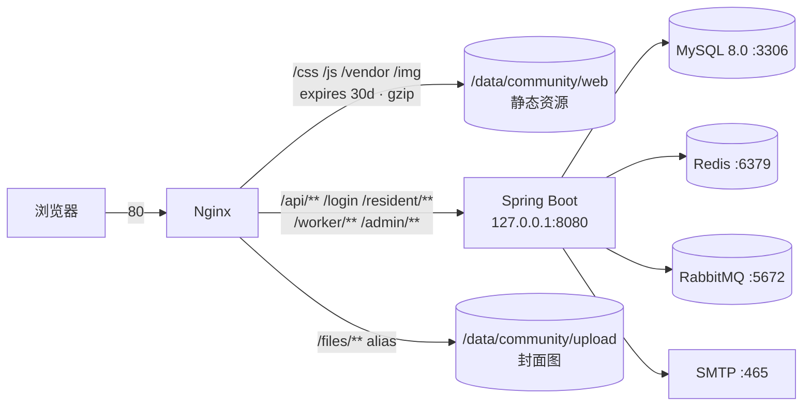

# 社区便民服务预约系统 · Linux 部署说明（Nginx 动静分离）

> 目标环境：CentOS 7+ / Rocky Linux 8+ / Ubuntu 20.04+，x86_64
> 部署形态：**Nginx 托管全部静态资源 + 反向代理应用**，Spring Boot 以 `prod` 环境独立运行
> 应用端口：`8080`（仅监听 `127.0.0.1`，不直接对外暴露）
> 对外端口：`80`（HTTP）

---

## 1. 部署拓扑



**动静分离的收益**：

| 维度 | 分离前（Spring Boot 托管静态） | 分离后（Nginx 托管） |
| --- | --- | --- |
| 静态资源吞吐 | 占用 Tomcat 线程，Bootstrap + ECharts 约 1.6MB，首屏并发时挤占业务线程 | Nginx `sendfile` 零拷贝直出，Tomcat 只处理 API 与页面 |
| 缓存控制 | 需在 Java 层配 `Cache-Control`，改一次重启一次 | Nginx 一行 `expires 30d`，改配置 `reload` 即可 |
| 压缩 | Tomcat 压缩耗 CPU | Nginx gzip 静态预压缩效率更高 |
| 上传目录 | 需写 Controller 或 `ResourceHandler` 映射 | Nginx `alias` 直接映射磁盘目录，应用只负责落盘 |

---

## 2. 环境准备

### 2.1 依赖版本

| 组件 | 版本要求 | 校验命令 |
| --- | --- | --- |
| JDK | 17（最低 11） | `java -version` |
| MySQL | 8.0 | `mysql --version` |
| Redis | 6.0+ | `redis-server -v` |
| RabbitMQ | 3.9+（含 Erlang） | `rabbitmqctl version` |
| Nginx | 1.20+ | `nginx -v` |

### 2.2 安装示例（Rocky / CentOS）

```bash
# JDK 17
sudo dnf install -y java-17-openjdk-headless

# MySQL 8.0（官方源）
sudo dnf install -y https://dev.mysql.com/get/mysql80-community-release-el8-9.noarch.rpm
sudo dnf install -y mysql-community-server
sudo systemctl enable --now mysqld

# Redis
sudo dnf install -y redis
sudo systemctl enable --now redis

# RabbitMQ（需先装 Erlang，推荐 rabbitmq/erlang 官方源）
sudo dnf install -y erlang rabbitmq-server
sudo systemctl enable --now rabbitmq-server

# Nginx
sudo dnf install -y nginx
sudo systemctl enable --now nginx
```

### 2.3 目录规划

```bash
sudo mkdir -p /data/community/{app,web,upload,logs,backup}
sudo useradd -r -s /sbin/nologin community || true
sudo chown -R community:community /data/community
```

| 路径 | 用途 |
| --- | --- |
| `/data/community/app/community-booking.jar` | 应用 jar（唯一需要发布的可执行文件） |
| `/data/community/web/` | Nginx 静态资源根目录（从 jar 中抽取的 `static/`） |
| `/data/community/upload/` | 封面图落盘目录（对应 `community.upload.dir`） |
| `/data/community/logs/` | 应用日志（对应 `logging.file.name`），交给 logrotate |
| `/data/community/backup/` | 数据库与配置备份 |

---

## 3. 数据库初始化

```bash
# 1) 建库建号（生产不要用 root 跑应用）
mysql -uroot -p <<'SQL'
CREATE DATABASE IF NOT EXISTS community_booking
  DEFAULT CHARACTER SET utf8mb4 COLLATE utf8mb4_general_ci;
CREATE USER IF NOT EXISTS 'community'@'127.0.0.1' IDENTIFIED BY '请替换为强密码';
GRANT ALL PRIVILEGES ON community_booking.* TO 'community'@'127.0.0.1';
FLUSH PRIVILEGES;
SQL

# 2) 导入初始化脚本（6 张表 + 种子数据）
mysql -ucommunity -p community_booking < /data/community/app/sql/community_init.sql

# 3) 校验
mysql -ucommunity -p community_booking -e "
SELECT 'sys_user' t, COUNT(*) c FROM sys_user UNION ALL
SELECT 'worker_profile', COUNT(*) FROM worker_profile UNION ALL
SELECT 'service_category', COUNT(*) FROM service_category UNION ALL
SELECT 'service_item', COUNT(*) FROM service_item UNION ALL
SELECT 'service_order', COUNT(*) FROM service_order UNION ALL
SELECT 'service_evaluation', COUNT(*) FROM service_evaluation;"
```

> **生产初始化后必须改密码**：种子账号密码统一为 `123456`，上线前逐个改为强密码（或直接删除演示账号，仅保留管理员并改密）。
> `community_init.sql` 使用 `DATE_SUB(NOW(), ...)` 之类的相对时间，导入时刻决定"近 7 日趋势"的观感；建议演示前重新导入一次。

---

## 4. RabbitMQ 配置

应用使用**独立 vhost**（`prod` 配置 `spring.rabbitmq.virtual-host: /community`），需先创建并授权：

```bash
sudo rabbitmqctl add_vhost /community
sudo rabbitmqctl add_user community '请替换为强密码'
sudo rabbitmqctl set_permissions -p /community community ".*" ".*" ".*"
sudo rabbitmqctl set_user_tags community management
```

**拓扑由应用自动声明**（`config/mq/RabbitMQConfig` 中的 `Queue`/`Exchange`/`Binding` Bean，由 `RabbitAdmin` 在连接建立后幂等创建）：

| 类型 | 名称 |
| --- | --- |
| 交换机 | `appoint.direct.exchange`、`appoint.dlx.exchange`、`appoint.delay.dlx.exchange` |
| 业务队列 | `appoint.notify.queue`、`appoint.eval.queue`、`appoint.cancel.queue` |
| 延迟队列 | `appoint.delay.queue`（TTL 30 分钟，无消费者） |
| 死信队列 | `appoint.notify.dlq`、`appoint.eval.dlq`、`appoint.cancel.dlq` |

> **注意：改了队列参数必须先删旧队列。** RabbitMQ 对同名队列做参数校验，TTL / DLX 参数不一致会抛 `PRECONDITION_FAILED - inequivalent arg 'x-message-ttl'`，应用启动日志会持续报错但不会崩溃。处理方式：管理台删除该队列（或 `rabbitmqctl delete_queue`）后重启应用，让其按新参数重建。
>
> 管理台默认在 `http://服务器IP:15672`，生产应只允许内网访问（防火墙限制或 Nginx 加 Basic Auth）。

---

## 5. 应用配置与环境变量

`prod` 配置（`application-prod.yml`）中所有敏感项都用 `${ENV:默认值}` 占位，**不要把密码写进配置文件**。用 systemd 的 `EnvironmentFile` 注入：

```bash
sudo tee /etc/sysconfig/community-booking >/dev/null <<'ENV'
# ===== 数据库 =====
DEPLOY_DB_HOST=127.0.0.1
DEPLOY_DB_PORT=3306
DEPLOY_DB_USER=community
DEPLOY_DB_PASSWORD=请替换为强密码

# ===== Redis =====
DEPLOY_REDIS_HOST=127.0.0.1
DEPLOY_REDIS_PORT=6379
DEPLOY_REDIS_PASSWORD=

# ===== RabbitMQ =====
DEPLOY_MQ_HOST=127.0.0.1
DEPLOY_MQ_PORT=5672
DEPLOY_MQ_USER=community
DEPLOY_MQ_PASSWORD=请替换为强密码

# ===== 邮件（QQ 企业邮箱示例，password 填授权码而非登录密码）=====
DEPLOY_MAIL_HOST=smtp.qq.com
DEPLOY_MAIL_PORT=465
DEPLOY_MAIL_USER=notice@your-domain.cn
DEPLOY_MAIL_PASSWORD=请替换为SMTP授权码
ENV

sudo chmod 600 /etc/sysconfig/community-booking
sudo chown root:root /etc/sysconfig/community-booking
```

### 5.1 systemd 服务单元

```bash
sudo tee /etc/systemd/system/community-booking.service >/dev/null <<'UNIT'
[Unit]
Description=Community Booking Appointment Service
After=network-online.target mysqld.service redis.service rabbitmq-server.service
Wants=network-online.target

[Service]
Type=simple
User=community
Group=community
WorkingDirectory=/data/community/app
EnvironmentFile=/etc/sysconfig/community-booking
# 显式指定端口：避免宿主机全局 SERVER_PORT 环境变量覆盖 prod 配置
ExecStart=/usr/bin/java -Xms512m -Xmx1024m \
  -Duser.timezone=Asia/Shanghai \
  -Dfile.encoding=UTF-8 \
  -jar /data/community/app/community-booking.jar \
  --spring.profiles.active=prod \
  --server.port=8080
SuccessExitStatus=143
Restart=on-failure
RestartSec=5
# 优雅停机：等待在途请求与 MQ 消费完成
KillSignal=SIGTERM
TimeoutStopSec=30
LimitNOFILE=65535

[Install]
WantedBy=multi-user.target
UNIT

sudo systemctl daemon-reload
sudo systemctl enable --now community-booking
sudo systemctl status community-booking --no-pager
```

### 5.2 关键配置项说明

| 配置 | 生产取值 | 说明 |
| --- | --- | --- |
| `server.port` | 8080 | 只监听本机，由 Nginx 反代 |
| `spring.thymeleaf.cache` | true | 模板强缓存，提升渲染吞吐 |
| `community.upload.dir` | `/data/community/upload` | 必须与 Nginx `alias` 一致 |
| `community.mail.enabled` | true | 真实投递；SMTP 未配好时会降级为日志 |
| `community.mq.eval-sync-fallback` | false | 评价绩效走纯异步，评价接口只 INSERT + 投递 |
| `community.mq.publish-enabled` | true | 生产必须投递（超时取消与通知都依赖 MQ） |
| `community.order.lock-seconds` | 30 | 订单状态机锁持有上限 |
| `community.dispatch.auto-threshold` | 60 | 一键派单最低分，低于此值要求人工指派 |
| `logging.file.name` | `/data/community/logs/community-booking.log` | 应用日志落盘位置 |

---

## 6. Nginx 配置（动静分离核心）

### 6.1 从 jar 中抽取静态资源

Spring Boot 的静态资源在 jar 内的 `BOOT-INF/classes/static/` 下，发布时解出来交给 Nginx：

```bash
cd /data/community/app
# 只解压静态资源，避免把 class 也铺到 web 目录
unzip -o community-booking.jar 'BOOT-INF/classes/static/*' -d /tmp/community-static
cp -r /tmp/community-static/BOOT-INF/classes/static/. /data/community/web/
rm -rf /tmp/community-static
chown -R community:community /data/community/web
ls /data/community/web     # 应看到 css/ js/ vendor/
```

> 前端资源变更（改 CSS/JS、升级 Bootstrap）时**必须重新执行上面两步**，否则 Nginx 仍发旧文件。
> 建议把这段写进发布脚本，与 jar 替换放在同一次操作里。

### 6.2 站点配置

```bash
sudo tee /etc/nginx/conf.d/community-booking.conf >/dev/null <<'NGINX'
upstream booking_app {
    server 127.0.0.1:8080;
    keepalive 32;
}

server {
    listen 80;
    server_name community.example.com;

    charset utf-8;
    client_max_body_size 50m;          # 与 spring.servlet.multipart.max-file-size 对齐

    access_log /var/log/nginx/booking-access.log;
    error_log  /var/log/nginx/booking-error.log warn;

    # ===== 1. 静态资源：Nginx 直出，不回源应用 =====
    location /css/    { root /data/community/web; expires 7d;  access_log off; }
    location /js/     { root /data/community/web; expires 7d;  access_log off; }
    location /vendor/ { root /data/community/web; expires 30d; access_log off; }
    location /img/    { root /data/community/web; expires 30d; access_log off; }

    # 图标字体：跨域与 MIME 都要显式声明，否则部分浏览器拒载 woff2
    location ~* \.(woff2?|ttf|eot)$ {
        root /data/community/web;
        expires 30d;
        add_header Access-Control-Allow-Origin *;
        types { font/woff2 woff2; font/woff woff; }
        access_log off;
    }

    # ===== 2. 上传的封面图：磁盘目录直出 =====
    location /files/ {
        alias /data/community/upload/;
        expires 7d;
        access_log off;
        # 上传目录禁止执行任何脚本（Nginx 本身不解析 PHP，这里是纵深防御）
        location ~* \.(php|jsp|sh|exe)$ { deny all; }
    }

    # ===== 3. 动态请求：反代到 Spring Boot =====
    location / {
        proxy_pass http://booking_app;
        proxy_http_version 1.1;
        proxy_set_header Connection "";
        proxy_set_header Host              $host;
        proxy_set_header X-Real-IP         $remote_addr;
        proxy_set_header X-Forwarded-For   $proxy_add_x_forwarded_for;
        proxy_set_header X-Forwarded-Proto $scheme;
        proxy_connect_timeout 5s;
        proxy_read_timeout    60s;
        proxy_send_timeout    60s;

        # 会话 Cookie 由应用写入，反代不缓存任何动态响应
        proxy_buffering off;
        proxy_no_cache 1;
        proxy_cache_bypass 1;
    }

    # ===== 4. 运维健康检查（不暴露到公网时用内网 ACL）=====
    location = /health {
        access_log off;
        proxy_pass http://booking_app/api/auth/me;
        proxy_set_header Host $host;
    }

    # ===== 5. gzip：静态文本压缩 =====
    gzip on;
    gzip_comp_level 5;
    gzip_min_length 1k;
    gzip_vary on;
    gzip_types text/plain text/css application/javascript application/json
               image/svg+xml application/xml;
}
NGINX

sudo nginx -t && sudo systemctl reload nginx
```

### 6.3 为什么这样切分 location

| 请求 | 处理者 | 理由 |
| --- | --- | --- |
| `/css/**` `/js/**` `/vendor/**` `/img/**` | Nginx 文件系统 | 内容不变、体积大（ECharts 约 1MB），走 Nginx 零拷贝最省资源 |
| `/files/**` | Nginx `alias` | 用户上传的封面图只读，无需经过鉴权（文件名含 UUID 不可枚举） |
| `/api/**`、`/login`、`/resident/**`、`/worker/**`、`/admin/**` | Spring Boot | 需要会话、鉴权、模板渲染与业务逻辑 |
| `/health` | 反代到 `/api/auth/me` | 未登录返回 401 即代表应用活着（能进 Security 过滤链说明容器已就绪） |

> **不要**把 `/` 也做成静态目录 + `try_files`：本项目是 Thymeleaf 服务端渲染，页面 HTML 必须由应用生成，`/` 必须反代。

### 6.4 HTTPS（可选但生产必备）

```bash
sudo dnf install -y certbot python3-certbot-nginx
sudo certbot --nginx -d community.example.com
# certbot 会自动改写 80 段配置并加 443 server 块；证书续期由 certbot-renew.timer 负责
```

启用 HTTPS 后需在反代头里保留 `X-Forwarded-Proto $scheme`，否则应用生成的绝对地址仍是 `http://`。

---

## 7. 上传目录权限

```bash
sudo mkdir -p /data/community/upload/item
sudo chown -R community:community /data/community/upload
sudo chmod -R 755 /data/community/upload
```

- 应用进程（`community` 用户）需要**写**权限，Nginx（`nginx` 用户）需要**读**权限；`755` 同时满足。
- 文件名为 UUID + 扩展名白名单（`jpg/jpeg/png/webp`），不与用户输入拼接，天然免疫路径穿越。
- 备份时 `upload/` 与数据库要一起备份：数据库存相对路径，文件丢失会导致封面 404。

---

## 8. 发布与回滚

### 8.1 发布脚本

```bash
sudo tee /data/community/app/deploy.sh >/dev/null <<'SH'
#!/usr/bin/env bash
set -euo pipefail

APP_DIR=/data/community/app
WEB_DIR=/data/community/web
JAR=$APP_DIR/community-booking.jar
NEW_JAR=${1:?用法: deploy.sh /path/to/new/community-booking.jar}

echo "[1/5] 备份当前版本"
cp -f "$JAR" "$APP_DIR/backup/community-booking-$(date +%Y%m%d%H%M%S).jar"

echo "[2/5] 替换 jar"
install -o community -g community -m 644 "$NEW_JAR" "$JAR"

echo "[3/5] 抽取静态资源到 Nginx 目录"
rm -rf /tmp/community-static
unzip -oq "$JAR" 'BOOT-INF/classes/static/*' -d /tmp/community-static
rsync -a --delete /tmp/community-static/BOOT-INF/classes/static/ "$WEB_DIR/"
rm -rf /tmp/community-static
chown -R community:community "$WEB_DIR"

echo "[4/5] 重启应用"
systemctl restart community-booking

echo "[5/5] 健康检查"
for i in $(seq 1 30); do
  code=$(curl -s -o /dev/null -w '%{http_code}' http://127.0.0.1:8080/api/auth/me || true)
  if [ "$code" = "401" ]; then echo "服务已就绪（/api/auth/me -> 401）"; exit 0; fi
  sleep 2
done
echo "启动超时，请查看 journalctl -u community-booking -n 200" >&2
exit 1
SH
sudo chmod +x /data/community/app/deploy.sh
```

> `rsync -a --delete` 会删掉 `WEB_DIR` 中 jar 里已不存在的旧文件（例如改名的 CSS），避免"旧文件残留导致样式错乱"。执行前请确认 `WEB_DIR` 只放静态资源。

### 8.2 回滚

```bash
sudo systemctl stop community-booking
sudo cp /data/community/app/backup/community-booking-<时间戳>.jar /data/community/app/community-booking.jar
sudo /data/community/app/deploy.sh /data/community/app/community-booking.jar
```

数据库结构变更需配套回滚脚本；本项目 Batch 1 的 `community_init.sql` 为全量重建脚本，回滚到旧版本时应同时恢复备份库。

---

## 9. 日志与监控

### 9.1 logrotate

```bash
sudo tee /etc/logrotate.d/community-booking >/dev/null <<'ROTATE'
/data/community/logs/*.log {
    daily
    rotate 14
    missingok
    notifempty
    compress
    delaycompress
    copytruncate
    su community community
}
ROTATE

sudo logrotate -d /etc/logrotate.d/community-booking   # dry-run 校验
```

`copytruncate` 适用于应用自己持有文件句柄（Logback 未配滚动）的场景，避免 `mv` 后进程继续写旧 inode。

### 9.2 日常巡检命令

```bash
# 服务状态与最近日志
systemctl status community-booking --no-pager
journalctl -u community-booking -n 100 --no-pager
tail -f /data/community/logs/community-booking.log

# 关键错误检索（ERROR 应为 0；Redis/MQ 故障会打 WARN 并降级）
grep -c ' ERROR ' /data/community/logs/community-booking.log
grep ' WARN ' /data/community/logs/community-booking.log | tail -20

# 中间件连通性
redis-cli -h 127.0.0.1 ping
rabbitmqctl list_queues -p /community name messages consumers
mysqladmin -ucommunity -p status
```

### 9.3 Web 冒烟（部署后自检）

```bash
cd /data/community/app
python3 scripts/smoke_web.py http://127.0.0.1:8080
```

期望输出 `PASS 36 / 36 · FINAL: ALL GREEN`。脚本会分别以管理员、师傅、居民登录，巡检 11 个页面与 14 个接口，并验证三条越权防线。

---

## 10. 常见问题排查

| 现象 | 原因 | 处理 |
| --- | --- | --- |
| 启动报 `Port 8080 was already in use` | 旧进程未退出，或宿主机全局 `SERVER_PORT` 覆盖了配置 | `ss -lntp \| grep 8080` 找到进程；systemd 已显式 `--server.port=8080` 覆盖环境变量 |
| 启动报 `PRECONDITION_FAILED - inequivalent arg 'x-message-ttl'` | 队列已存在且 TTL/DLX 参数与代码不一致 | 管理台删除对应队列后重启应用重建 |
| 页面能开但样式全丢 | 静态资源未抽取或 `WEB_DIR` 路径不对 | 检查 `/data/community/web/css/app.css` 是否存在，`nginx -t` 后 reload |
| 登录后立刻跳回 `/login` | Nginx 未透传 `Cookie`/`Host`，或会话 Cookie 域不匹配 | 确认反代头含 `Host`、`X-Forwarded-Proto`；同域部署无需改 Cookie 域 |
| 下单后 30 分钟订单没自动取消 | MQ 未连通或消费者未启动 | 查 `publish-enabled`、vhost 是否为 `/community`、`appoint.cancel.queue` 的 consumers 是否为 1 |
| 评价后师傅评分没变 | 生产走异步重算，MQ 不通或消费失败 | 查 `appoint.eval.queue` 堆积与 `appoint.eval.dlq`；临时可把 `eval-sync-fallback` 置 true |
| 邮件发送失败 `535 Authentication failed` | 用的是登录密码而非 SMTP 授权码 | 在邮箱后台生成授权码填入 `DEPLOY_MAIL_PASSWORD` |
| 看板图表空白 | `/vendor/echarts.min.js` 404 或接口 403 | 查 Network 面板；确认静态资源已抽取且当前账号为管理员 |
| 中文乱码 | 数据库/连接串/JVM 编码不一致 | 库用 `utf8mb4`，连接串含 `characterEncoding=utf-8`，JVM 加 `-Dfile.encoding=UTF-8` |
| 时间差 8 小时 | JVM 时区非东八区 | `-Duser.timezone=Asia/Shanghai`（systemd 单元已包含） |

---

## 11. 上线安全清单

- [ ] 修改所有种子账号密码，删除不用的演示账号
- [ ] 数据库使用独立低权限账号，禁止 root 远程登录
- [ ] Redis 设置 `requirepass` 并只监听内网；禁止公网暴露 6379
- [ ] RabbitMQ 管理台（15672）仅内网可访问，删除 `guest` 远程登录
- [ ] Nginx 启用 HTTPS，HTTP 301 跳转
- [ ] 关闭 Swagger/Actuator 等调试端点（本项目未引入，无需处理）
- [ ] `/data/community` 权限收敛到 `community` 用户，配置文件 `600`
- [ ] 配置数据库每日全量备份 + binlog，备份文件异地保存
- [ ] 配置日志轮转与磁盘告警（`/data` 使用率 > 80% 告警）
- [ ] `community.dispatch.auto-threshold` 按实际运力调整（师傅少时调高，避免误派）
